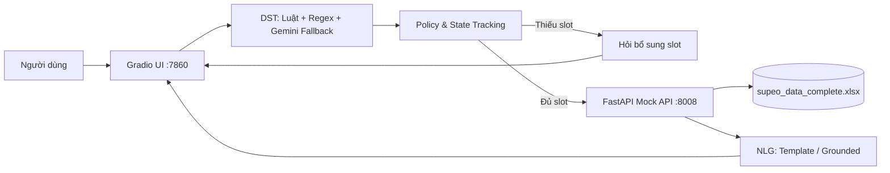

#Chatbot — Trợ Lý Tư Vấn Thời Trang Đa Lượt (HCI_Chatbot)

Chatbot tư vấn thời trang nữ theo kiến trúc **Task-Oriented Dialogue (TOD / SGP-TOD)**, kết hợp **Luật + Regex** và **Gemini (Fallback)** để hiểu ngữ cảnh đa lượt, truy xuất dữ liệu thực từ **FastAPI** và phản hồi chính xác tuyệt đối theo dữ liệu (không bịa số liệu).

---

## 1. Điểm Nổi Bật & Tư Duy Thiết Kế

- **Kiến trúc Hybrid (Luật/Regex + LLM Fallback):**
  - Lớp **Luật + Regex + Lexicon động** (nạp trực tiếp từ API, không hardcode danh mục/dịp/mã voucher) xử lý nhanh, nhất quán các câu hỏi chuẩn và ngữ cảnh đa lượt.
  - **Gemini** (`gemini-3.5-flash-lite` mặc định) đóng vai trò **Fallback** khi luật chưa bắt đủ ý, giúp hiểu ngôn ngữ tự nhiên linh hoạt mà không làm tăng độ trễ ở các lượt thông thường.
- **Zero-Hallucination (Grounding 100% từ API):**
  - Mọi thông tin về giá, tồn kho, size (thuật toán *Max-Boundary*), trạng thái đơn hàng và mã giảm giá đều bắt buộc đi qua **FastAPI Mock API** đọc từ `supeo_data_complete.xlsx`.
- **Hiểu Ngữ Cảnh Đa Lượt (Multi-turn Context):**
  - Nhớ món đang xem để tư vấn phối đồ/chất liệu/màu sắc tiếp theo.
  - Hiểu tham chiếu theo thứ tự hoặc mã (`"mẫu thứ 2"`, `"cái đầu tiên"`, `"P03"`).
  - Bóc tách vế phủ định (`"váy chứ không phải quần ống rộng"` $\rightarrow$ lấy `váy`).
  - Không hỏi lại thông tin đã cung cấp (chiều cao, cân nặng, mã đơn `#SPxxxx`).

---

## 2. Kiến Trúc Hệ Thống



---

## 3. Các Nghiệp Vụ (Intents) & API Hỗ Trợ

| Intent | Chức năng | Slot bắt buộc | Endpoint API |
| :--- | :--- | :--- | :--- |
| `product_info` | Tìm kiếm & xem chi tiết sản phẩm (loại, màu, chất liệu) | `loai_do` (hoặc `ten_sp`, `tu_khoa`) | `GET /v1/products`, `GET /v1/products/{id}` |
| `size_advice` | Tư vấn size theo số đo (Max-Boundary) | `chieu_cao` (cm), `can_nang` (kg) | `GET /v1/size-advice` |
| `lookbook` | Gợi ý set đồ theo dịp mặc & phối đồ | `dip_mac` | `GET /v1/lookbook`, `GET /v1/lookbook/{occasion}` |
| `order_check` | Tra cứu trạng thái đơn hàng | `ma_don` (`#SPxxxx`) | `GET /v1/orders/{order_id}/tracking` |
| `voucher` | Kiểm tra & gợi ý mã giảm giá còn hạn | *(tùy chọn `ma_voucher`, `cart_total`)* | `GET /v1/vouchers/available`, `GET /v1/vouchers/{ma}` |
| `chitchat` | Chào hỏi, cảm ơn, hỏi ngoài phạm vi | — | — |

---

## 4. Cấu Trúc Dự Án

```text
chatpot/
├── supeo_app.py              # Ứng dụng chính: tự bật FastAPI nền + DST/Policy/NLG + Gradio UI
├── supeo_api.py              # FastAPI Mock API độc lập đọc dữ liệu từ Excel
├── supeo_data_complete.xlsx  # Dữ liệu sản phẩm, bảng size, lookbook, đơn hàng, voucher
├── chatpot.ipynb             # Notebook phát triển, thử nghiệm và chạy bộ đánh giá
├── supeo_results/            # Kết quả kiểm thử hồi quy (CSV & ghi chú cấu hình chạy)
└── supeo_results.zip         # Bản nén kết quả kiểm thử
```

---

## 5. Kết Quả Đánh Giá (Benchmark)

Đánh giá hệ thống trên **4 bộ kiểm thử A + B + C + D** (ngày giả lập API `2026-10-28`, chế độ `luật + regex` v5/v6):

### Tổng hợp theo từng bộ (A, B, C, D)

| Bộ kiểm thử | Vai trò | Đơn lượt (Số câu / Đúng hết) | Đa lượt (Hội thoại / Đúng từng lượt) |
| :--- | :--- | :---: | :---: |
| **A (DEV)** | Hồi quy — tinh chỉnh | 30/30 (`100,00%`) | 6/6 (`100,00%` — 16/16 lượt) |
| **B (TEST)** | Hồi quy — kiểm lỗi | 30/30 (`100,00%`) | 6/6 (`100,00%` — 17/17 lượt) |
| **C (FRESH)** | Khách quan — chạy 1 lần | 24/24 (`100,00%`) | 5/5 (`100,00%` — 17/17 lượt) |
| **D (HARD BLIND TEST)** | Kiểm thử thực tế nhiễu tự nhiên (không sửa code) | 27/30 (`90,00%`) | 5/6 (`83,33%` — 16/18 lượt) |

### Chi tiết các chỉ số tổng hợp (A + B + C + D)

- **Hội thoại Đơn lượt (Single-turn — Tổng 114 câu):**
  - **Intent Accuracy:** `100,00%` (`114/114` câu)
  - **Exact Slot Accuracy:** `97,37%` (`111/114` câu)
  - **Action Accuracy:** `98,25%` (`112/114` câu)
  - **Reply Accuracy:** `98,25%` (`112/114` câu)
  - **All-4 Accuracy (Đúng hết 4 tiêu chí):**
    - *Micro-average (theo tổng số câu):* `97,37%` (`111/114` câu)
    - *Macro-average (trung bình 4 bộ):* `97,50%` (độ lệch chuẩn `5,00%`, trung vị `100,00%`, thấp nhất `90,00%` ở Bộ D, cao nhất `100,00%` ở Bộ A, B, C)
- **Hội thoại Đa lượt & Ghi nhớ ngữ cảnh (Multi-turn — Tổng 23 cuộc hội thoại, 68 lượt):**
  - **Turn-level Accuracy:** `97,06%` (`66/68` lượt); Macro-average 4 bộ đạt `97,22%` (độ lệch chuẩn `5,56%`, trung vị `100,00%`, từ `88,89%` đến `100,00%`)
  - **Conversation-level Accuracy:** `95,65%` (`22/23` cuộc hội thoại); Macro-average 4 bộ đạt `95,83%` (độ lệch chuẩn `8,33%`, trung vị `100,00%`, từ `83,33%` đến `100,00%`)
- **Gộp chung toàn bộ 4 bộ A + B + C + D (Đơn lượt + Đa lượt):**
  - Trên tổng số **182 lượt truy vấn** (114 câu đơn + 68 lượt đa), hệ thống xử lý chính xác hoàn toàn **177/182 lượt**, đạt độ chính xác tổng thể **`97,25%`**.

> *(Ngoài ra, kết quả lưu trữ thêm của bộ hồi quy `HELDOUT_CU` và chế độ `Gemini+luat` được giữ tại [`supeo_results/supeo_results/tom_tat_diem.csv`](supeo_results/supeo_results/tom_tat_diem.csv).)*

---

## 6. Hướng Dẫn Cài Đặt & Chạy

### Yêu cầu môi trường
- Python 3.9+
- Cài đặt các thư viện cần thiết:

```bash
pip install "gradio>=5,<6" fastapi "uvicorn[standard]" requests pandas openpyxl
```

*(Tùy chọn: cài thêm `google-genai` và đặt `GEMINI_API_KEY` nếu muốn bật chế độ Gemini fallback.)*

### Chạy toàn bộ Chatbot (UI + API nền)

```bash
python supeo_app.py
```
Sau khi chạy, mở trình duyệt tại:
- **Giao diện Chatbot (Gradio):** `http://127.0.0.1:7860`
- **Tài liệu API (Swagger UI):** `http://127.0.0.1:8008/docs`

### Chạy riêng Mock API

```bash
uvicorn supeo_api:app --port 8008
```

### Biến môi trường hỗ trợ

| Biến | Mô tả | Mặc định |
| :--- | :--- | :--- |
| `SUPEO_XLSX` | Đường dẫn tới file Excel dữ liệu | Tự tìm `supeo_data_complete.xlsx` |
| `SUPEO_TODAY` | Giả lập ngày hiện tại (`YYYY-MM-DD` hoặc `dd/mm/yyyy`) để test voucher/đơn hàng | Ngày hệ thống |
| `GEMINI_API_KEY` | API key để bật Gemini fallback | Không bắt buộc |
| `SUPEO_NO_LAUNCH` | Đặt `1` nếu chỉ nạp bot để test, không mở Gradio UI | `0` |
